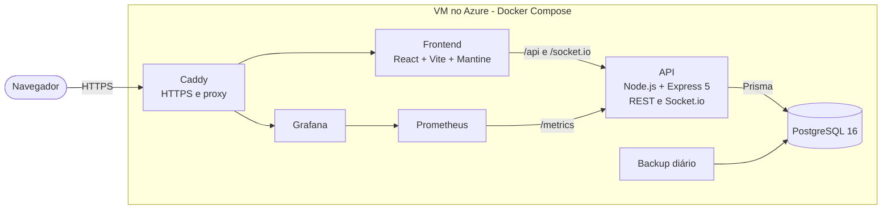

# Portal Coopersign

Sistema web de gestão e orquestração da produção da **Coopersign**, cooperativa de comunicação visual (impressão digital de grandes formatos e recorte eletrônico).

**Aplicação no ar:** https://coopersign.chilecentral.cloudapp.azure.com
**Documentação completa:** [Wiki do projeto](https://github.com/sidneyoliveiraj/Portal-Coopersign/wiki)

## Motivação

Na Coopersign, pedidos, fila das máquinas e cobrança eram controlados em planilhas, papel e de cabeça. Isso gerava erro no cálculo de metragem e valor, fila organizada de cabeça, retrabalho sem registro, fechamento de conta do cliente que levava horas e cliente ligando para saber se o pedido estava pronto.

O Portal Coopersign leva o pedido do começo ao fim:

1. **Entrada do pedido** com cálculo automático de metragem e valor (com a cobrança mínima de 1 m² por peça) e leitura das medidas direto do arquivo de arte.
2. **Validação técnica** pelo finalizador, que aprova e escolhe a máquina ou rejeita com o motivo.
3. **Fila de produção por máquina**, ordenada por prazo e atualizada em tempo real em todas as telas.
4. **Retrabalho** registrado com motivo e custo.
5. **Fechamento de conta** dos clientes que pagam no fim do período, com comprovante para imprimir.
6. **Relatórios e indicadores**: receita, pedidos por máquina e material, gasto com retrabalho e tempo médio de produção.
7. **Portal do cliente** para acompanhar os próprios pedidos.

## Arquitetura



A API é organizada em camadas: `routes` → `controllers` → `services` (regras de negócio) → `repositories` (Prisma). Os dados de cada organização ficam isolados por `organizacao_id`, aplicado automaticamente em toda consulta. Diagramas C4 completos e o modelo de dados estão em [Arquitetura](https://github.com/sidneyoliveiraj/Portal-Coopersign/wiki/Arquitetura).

| Camada | Tecnologias |
|---|---|
| Frontend | React 19, TypeScript, Vite, Mantine, Socket.io client |
| Backend | Node.js 22, TypeScript, Express 5, Prisma 7, Socket.io, JWT, bcrypt |
| Banco | PostgreSQL 16 |
| Infra | Docker, GitHub Actions, Caddy, Azure |
| Qualidade | Vitest, Testing Library, Biome, ESLint, SonarCloud |
| Observabilidade | Prometheus, Grafana |

## Como rodar localmente

Pré-requisitos: Node.js 22 e Docker.

```bash
docker compose up -d                  # PostgreSQL na porta 5432

cd backend
npm install
cp .env.example .env
npx prisma migrate deploy
npx tsx prisma/seed.ts                # usuários de teste, senha senha123
npm run dev                           # API em http://localhost:3000

cd ../frontend                        # em outro terminal
npm install
npm run dev                           # http://localhost:5173
```

Usuário de teste: `admin@coopersign.dev` / `senha123`. Detalhes, outros perfis e como mudar o banco em [Execução local](https://github.com/sidneyoliveiraj/Portal-Coopersign/wiki/Execucao-Local).

## Testes

```bash
cd backend && npm run test:coverage    # 287 testes, 94,6% das linhas
cd frontend && npm run test:coverage   # 68 testes, acima de 45% das linhas
```

O CI roda lint, build, testes com cobertura e SonarCloud em todo pull request. Mais em [Testes e qualidade](https://github.com/sidneyoliveiraj/Portal-Coopersign/wiki/Testes-e-Qualidade).

## Deploy

Todo push na `main` que passa no CI é publicado sozinho pelo workflow **Deploy**: as imagens Docker recebem a tag do commit, vão para o GitHub Container Registry e a VM é atualizada. Para voltar uma versão, basta rodar o workflow informando o commit. Passo a passo, secrets e monitoramento em [Deploy e operação](https://github.com/sidneyoliveiraj/Portal-Coopersign/wiki/Deploy-e-Operacao).

## Decisões técnicas

As escolhas e mudanças importantes estão registradas como ADRs em [Decisões técnicas](https://github.com/sidneyoliveiraj/Portal-Coopersign/wiki/Decisoes-Tecnicas). Entre elas: por que Node.js com Express, por que Prisma, como funciona o multi-tenant, a regra de cobrança mínima de 1 m², a leitura das medidas do arquivo no navegador, o retrabalho único e a hospedagem no Azure.

## Estrutura do repositório

```
backend/     API (src/routes, controllers, services, repositories, lib, middlewares) e prisma/
frontend/    SPA (src/pages, components e funções puras testadas)
deploy/      docker-compose de produção, Caddyfile, Prometheus e painel do Grafana
.github/     CI, deploy e modelo de pull request
```

## Como contribuir

Abra uma issue, crie uma branch a partir da `main`, escreva o teste antes do código e abra um pull request. O CI e o Quality Gate do SonarCloud precisam passar.

## Licença

Código sob a licença [MIT](LICENSE).

## Licenças de terceiros

O projeto usa apenas bibliotecas de código aberto com licenças permissivas: MIT (React, Mantine, Express, Socket.io, bcrypt, helmet, jsonwebtoken, Recharts, pdf-lib), Apache 2.0 (Prisma, prom-client), BSD-2-Clause (dotenv) e MIT-0 (Nodemailer). Na infraestrutura: PostgreSQL (PostgreSQL License), Caddy e Prometheus (Apache 2.0) e Grafana (AGPL 3.0, usado sem modificação).

## Autor

Sidney Cardoso de Oliveira Junior. Projeto de Portfólio e PAC Extensionista VIII, Engenharia de Software, Católica SC, 2026, em parceria com a Coopersign.
